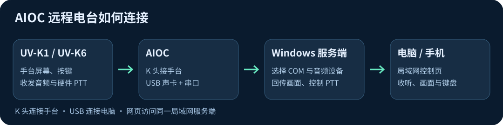
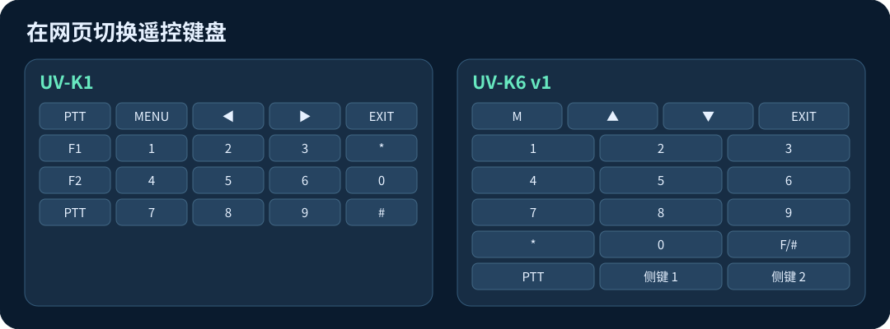

# K1 / K6 AIOC 远程电台

用 Windows 电脑连接 AIOC，在电脑或手机浏览器上收听、查看手台屏幕和控制电台。AIOC 提供 USB 声卡与硬件 PTT，画面和按键通过串口传输。

## 在线体验

[打开 K1 / K6 模拟网页](https://bush688.github.io/k1-k6-aioc/demo.html)。可切换 K1 / K6 键盘和短波模式，试用调谐、模拟收听及按住 PTT。模拟在浏览器内运行，无需电台或 AIOC。下方「网页与 Android 界面」介绍实际界面的入口和功能。

## AIOC 是什么

AIOC（All-In-One Cable）是开源的手台接口。K 头接手台的耳机与话筒插座，USB 接电脑。电脑端会看到 USB 麦克风、扬声器和一个 COM 口。USB 声卡传输收发音频，DTR 控制硬件 PTT，串口交换屏幕和按键数据。手台需要安装支持对应画面协议的固件。 [AIOC 项目与硬件资料](https://github.com/skuep/AIOC) · [AIOC 接线及用法](https://github.com/skuep/AIOC/wiki/Getting-Started)

| 功能 | UV-K1 | UV-K6 v1（SI4732 改装） |
| --- | --- | --- |
| AIOC 接收音频和 DTR PTT | 已使用 | 已实机确认 PTT |
| 普通手台屏幕回传 | K5Viewer 兼容固件 | 0.13.3 HS 提速版已实机确认 |
| 网页遥控键盘 | K1 布局 | K6 布局，普通通联和短波界面按键已实机确认 |
| 短波收音 | 依机型和固件 | SI4732 短波画面与远程按键已实机确认 |
| 信道写频及亚音 | 支持项目验证过的 K1 存储布局 | K6 存储布局未验证，请使用对应写频工具 |

服务端支持电脑耳机和话筒、手机收听与 PTT、预制语音和设备选择。网页键盘可在 UV-K1 与 UV-K6 v1 之间切换，并记住本浏览器的选择。手机浏览器可收听和控制，手机话筒回传需 Android 客户端。云希语音合成会将待朗读文字发送给微软服务，录音和已缓存的语音可以本地使用。

## 刷机与写频工具

| 工具 | 用途 | 入口 |
| --- | --- | --- |
| UV Studio | UV-K1 固件刷写、校准备份与恢复 | [打开 UV Studio](https://armel.github.io/uvstudio/) · [使用说明](https://armel.github.io/manual/pages/UV-Studio.html) |
| K5Web | UV-K6 v1 固件升级、EEPROM 备份及字库管理 | [打开 K5Web 固件升级](https://k5.vicicode.com/#/tool/flash) · [工具源码](https://github.com/silenty4ng/k5web) |
| AIOC 官方资料 | 硬件接线、AIOC 自身固件与故障排查 | [AIOC 发布页](https://github.com/skuep/AIOC/releases) · [故障排查](https://github.com/skuep/AIOC/wiki/Troubleshooting) |

网页工具使用桌面版 Chrome 或 Edge。刷机前关闭占用串口的程序。手台固件与 AIOC 适配器自身固件分别在各自的工具中升级。

## Windows 服务端 v8.8

在「电脑耳机收听 / 话筒发射」勾选「锁定音频设备」，可锁定接收、发射、耳机和话筒的设备选择。滚轮经过下拉框时只滚动窗口。

安装 Python 和依赖后，从仓库根目录启动。

    py -m venv .venv
    .venv\Scripts\python.exe -m pip install -r requirements.txt
    .venv\Scripts\python.exe gui.py

1. 选择 AIOC 对应的 COM 口，波特率 38400，PTT 方式选择 **AIOC DTR**。
2. 接收采集选择 **麦克风 (AIOC Audio)**，发射输出选择 **扬声器 (AIOC Audio)**。电脑耳机和电脑话筒分别选择自己的设备。
3. 在 Windows 窗口打开控制页。手机使用窗口显示的局域网地址，访问令牌等同于控制权限，请妥善保管。
4. 先测试接收和本机画面，再按住 PTT 测试发射，松手确认退发。仅通过已获许可的频率和功率发射。

## 网页与 Android 界面

- **浏览器遥控页**：打开 Windows 服务端提供的地址。页面显示手台屏幕、K1／K6 v1 遥控键盘、收听和 PTT，并提供频率、信道与预制语音操作。Windows 端的音频设备锁定位于电脑服务端的设置中。
- **Android 遥控端**：在「K1 远程收听」里点「地址设置」，填入 Windows 服务端地址，再点「打开」。上方是服务端提供的遥控网页，下方可用「后台收听」「停止」「刷新」。使用话筒回传或录音时，按系统提示授予麦克风权限。
- **Android 本机服务端**：在「K1 手机服务端」中用 USB OTG 连接 AIOC，通过「服务设置」选择 USB 输入和发射输出、启动音频并复制局域网地址。其他设备可通过该地址访问手机提供的控制页。

| 功能 | Windows v8.8 + 浏览器或 Android 遥控端 | Android v0.2.8 本机服务端 |
| --- | --- | --- |
| 界面来源 | Windows 提供网页，Android 连接后显示该网页 | APK 自带独立控制页 |
| 收听、PTT、画面、按键和信道读写 | 由 Windows 服务端提供 | 已有独立实现 |
| K1／K6 v1 键盘切换与短波优化 | Windows 遥控页支持机型切换，K6 短波画面提速还需对应固件 | 自带页面仍为 K1 布局，K6 短波控制未在手机服务端验证 |
| 预制语音与云希合成 | 由 Windows 服务端提供 | 尚未同步 |
| 音频设备滚轮锁定 | Windows v8.8 桌面设置功能 | 手机用 USB 设备选择按钮，没有同样的滚轮锁定设置 |

Android v0.2.8 的普通版和录音版使用相同的手机服务端网页。连接 Windows 可使用它提供的网页功能，切换到手机本机服务端则使用上表中的独立功能。[Windows 与 Android 下载](https://github.com/bush688/k1-k6-aioc/releases/tag/v8.8)

## K1 刷机

已安装并能回传画面的 K1 可以直接使用。需要更新时，先备份信道、设置和校准。按所选 K1 固件的上游说明进入升级模式，通过 UV Studio 普通固件刷写入口选择匹配 UV-K1 的程序固件。完成后检查机型键盘布局，再验证画面、按键及 AIOC。本仓库提供 K1 定制程序固件、上游许可证与署名。对应修改版源码尚未找齐。 [F4HWN K1 上游](https://github.com/armel/uv-k1-k5v3-firmware-custom)

[下载 K1 定制固件](firmware/k1/K1-6.3-Labs-CN-DTrac-PTT-AudioScope-test.bin) · [K1 固件说明](firmware/k1/README.md)

## K6 v1 刷机与恢复

普通通联和 SI4732 收音机界面均优先回传变化的屏幕区域，并定期补发全屏。网页键盘选择 **UV-K6 v1**。短波界面远程按键按短按处理。

已实测的提速版适用于 **UV-K6 v1、SI4732 硬件改装、满足 HS 要求的 EEPROM 扩容**。上游 HS 要求至少 2 Mbit EEPROM。先备份 EEPROM、信道和校准，并准备已验证可启动的原版 HS 固件。

1. 关掉远程服务端释放串口，K6 关机，按住机身 PTT 开机，确认机顶灯常亮。
2. 使用 Chrome 或 Edge 打开 K5Web 的「固件升级」，选择写频线对应串口和本仓库的 K6 提速版固件。 [K5Web](https://k5.vicicode.com/)
3. 等到工具显示升级成功后重启。检查机身画面和短波，再接 AIOC 验证普通通联和短波界面的网页画面及按键，再在通联界面验证 AIOC PTT。
4. 如果升级停滞，确认进度确实停止，再重新进入升级模式。优先用已验证原版恢复。原字库正常时可直接保留，字库和 SI4732 SSB 补丁是独立的 EEPROM 内容。 [下载原版 HS 恢复固件](firmware/k6-v1/LOSEHU133HS-upstream.bin)

[下载 K6 提速版](firmware/k6-v1/K6-v1-133HS-SI4732-keys-fast-screen.packed.bin) · [K6 源码基线与构建说明](firmware/k6-v1/README.md)

## 开源协议

本仓库的原创服务端代码和 K6 修改采用 Apache-2.0。K6 基于 losehu 的 Apache-2.0 固件，保留上游许可、作者标注和修改补丁。依赖和上游固件各自适用原协议。 [Apache-2.0 许可](LICENSE) · [AIOC 上游](https://github.com/skuep/AIOC)

如需本机打包 Windows EXE，安装 PyInstaller 后运行。

    .venv\Scripts\python.exe -m pip install pyinstaller
    .venv\Scripts\python.exe -m PyInstaller --onefile --windowed --name K1RemoteReceiveGUI-AIOC gui.py
